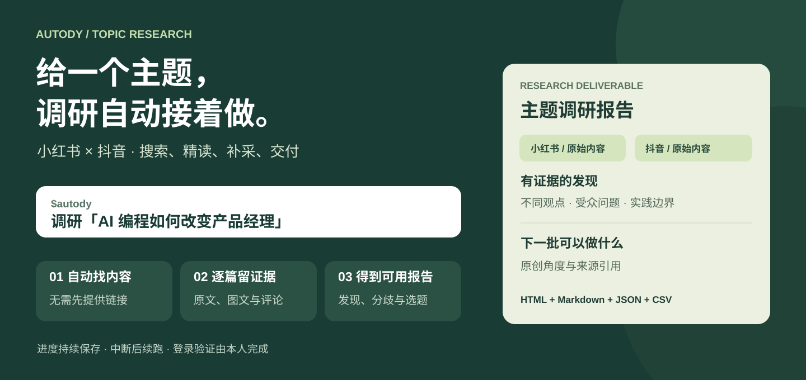

<p align="center"></p>

# Autody：输入一个 topic，自动做双平台调研

给 Codex 一个主题，Autody 会在你已登录的 Chrome 中搜索小红书和抖音，打开相关作品、阅读原始内容与评论、补齐重要缺口，交付带来源的调研报告和内容选题。你不需要先找链接，也不需要逐个调用 Skills。

```text
使用 $autody 调研「AI 编程如何改变产品经理」，自动跑小红书和抖音，
比较不同观点、受众问题和内容机会，最后给我带来源的报告。
```



这是由当前 Codex 会话执行的 Skill 工作流。浏览器操作和研究判断由 agent 完成，本地脚本保存进度、校验证据并生成报告。安装后，在 Codex 中发出上面的请求即可启动；单独运行 CLI 不会启动无人值守浏览器服务。

## 安装与更新

需要 Node.js 18+、支持 Chrome 操作的 Codex 环境和 Codex Chrome Extension。浏览器采用 **Chrome Extension-first**，复用现有登录会话。

```bash
git clone --branch codex/social-radar https://github.com/kizzhang/autody.git
cd autody
node bin/autody.js install
```

一次安装全部 **10 个 Skills**。从分享 ZIP 使用时，解压后进入包含 `bin/`、`skills/` 的 Autody 目录，执行同一条安装命令。

升级已有版本：先备份自己修改过的同名 Skill，再在仓库运行：

```bash
git pull --ff-only
node bin/autody.js install --force
node bin/autody.js doctor
```

本次版本为 GitHub 预发布 `0.0.5-topic.1`，位于 [PR #10](https://github.com/kizzhang/autody/pull/10) 的 `codex/social-radar` 分支；上面的安装命令直接取得该版本。npm `latest` 不一定包含它；本次更新没有执行 npm 发布。


## 输入主题以后，会自动做什么

1. 建立或恢复同一份主题任务，推导搜索词。默认每个平台精读 6 篇；可以直接说“先各读 3 篇”。
2. 在小红书、抖音的可见搜索界面执行检索，保存结果页和发现的链接。结果卡片只算线索。
3. 打开相关作品，保存原文、图文页面、可用视频文本与评论；记录相关性、阅读范围和缺口。无关内容不凑数。
4. 审读证据，自动补采重要遗漏，保留相反观点。需要视频文本时复用点点／豆包提取流程；AI 候选稿与已核对原文分别标记。
5. 汇总双平台发现、受众问题和可创作的角度，输出 HTML、Markdown、JSON 和证据 CSV。

中断后说“继续这个主题”，会沿用原任务和已读材料。需要重新调研时说“为这个主题开新一轮”。单个平台遇到登录或验证码时保存断点，继续另一平台；本人完成验证后恢复。样本不足会交付明确标记的部分报告，不会冒充双平台完成。


完成判定同时检查检索证据、双平台相关样本、有效审读、待补采任务和报告引用。只凑满数量不会显示完成；证据或报告文件丢失、修改后，状态会要求重新处理。

## 输出与续跑

资料保存在用户项目的输出目录，遵循工作区归档规则，位于源码及安装目录之外。

```text
topic-主题-稳定编号/
  task.json                  # 当前阶段、搜索计划、相关性、阻塞和交付记录
  events/                    # 只追加的采集、审读、补采历史
  searches/                  # 实际搜索结果证据
  materials/                 # 原文、截图、评论及提取候选稿
  deliveries/每次交付编号/
    research.html            # 双平台调研发现与内容机会
    research.md
    research.json
    evidence/report.html     # 可筛选的素材与证据视图
    evidence/tracking.csv
```


需要写稿，可以一次说“调研后选出最适合我的两个角度并写口播初稿”。这个指令已包含选题授权，agent 会继续写稿，无需再次等待选择。仅请求调研时，交付发现和选题；发布内容需另行明确请求。

## 三种任务，统一入口

| 需求 | 说法／入口 | 自动衔接 |
| --- | --- | --- |
| 已有 topic | `$autody 调研……` | 搜索双平台 → 采集 → 相关性判断 → 审读／补采 → 调研报告 |
| 暂无 topic，找方向 | `$social-radar 找适合我的选题` | 推荐流发现 → 素材与评论 → 观察池／到期复看 → 选题与获授权初稿 |
| 复盘自己的账号 | `$autody 复盘我的抖音账号并给报告` | 建档或更新 → 体检 → 按缺口补采 → 最新分析 → Lumina HTML |

主题调研不套用开放发现模式的“每平台 25 条”、推荐流或实用 AI 题材配额。开放发现的短时增长必须有相隔足够时间的真实观测，单个赞数不能证明增长。定时运行使用宿主调度器，只有明确要求时间、时区和资料库后才设置；安装不会创建定时任务。

账号复盘仅处理你本人或明确获授权的后台数据。抖音后台的播放、留存、完播率等与公开内容研究分开；公开赞数不会换算成后台指标。**小红书创作者后台分析尚未实现。**

## 现有 Skills 怎么串起来

| Skill | 在整体流程中的职责 |
| --- | --- |
| [autody](skills/autody/SKILL.md) | 总入口、任务状态、双平台编排与最终交付 |
| [social-radar](skills/social-radar/SKILL.md) | 公开素材事件库、审读、补采、复看、证据与初稿 |
| [xiaohongshu-analysis](skills/xiaohongshu-analysis/SKILL.md) | 原笔记核对、点点视频文本提取；也可单独处理已知链接 |
| [douyin-analysis](skills/douyin-analysis/SKILL.md) | 抖音后台数据口径、豆包提取与账号分析脚本 |
| [/kaishi](skills/kaishi/SKILL.md)、[/gengxin](skills/gengxin/SKILL.md) | 首次建档或增量刷新 |
| [/tijian](skills/tijian/SKILL.md)、[/buchong](skills/buchong/SKILL.md) | 本地审计、按缺口补采 |
| [/baogao](skills/baogao/SKILL.md)、[/html](skills/html/SKILL.md) | 重算最新分析、渲染 Lumina 账号报告 |

单独调用短命令时保留它原有的范围，例如 `/kaishi` 只负责建档。请求完整账号报告时，总入口会接着运行后续阶段。公开主题材料使用独立的调研报告，不进入抖音后台评分脚本。

## 实测范围

2026-10-27 在 Windows Chrome 登录会话中，以“AI 编程如何改变产品经理”为主题，执行双平台搜索和各 3 篇小样本审读，再生成同一份引用报告。小红书包含逐页图文、完整正文和评论；抖音采用详情页完整文案及可见评论。两次小红书登录／短信验证由本人完成，之后继续原任务，无需用户提供作品链接。

实测不代表所有视频已完整转录，也不代表 50 条批量流程或全天无人值守已验收。抖音一次 AI 侧栏未返回内容，报告保留了口播缺口；作者自述的开发速度等只作为观点材料。详细记录见 [实测说明](docs/validation/2026-10-27-topic-research.md)。此前 2026-10-07 的单条小红书点点试验保留 `ai_extracted_unverified` 状态，未核验的候选稿不会变成已验证逐字稿。

## 开发与本地检查

```bash
npm test
npm run pack:dry
node bin/autody.js doctor --package-only
node bin/autody.js research --topic "你的主题" --root "项目输出目录"
```

最后一条命令准备或恢复任务并返回下一步动作；浏览器步骤由当前 agent 执行。内部接口见 [主题工作流](skills/autody/references/topic-workflow.md)、[账号编排](skills/autody/references/account-orchestration.md)、[事件数据契约](skills/social-radar/references/data-contract.md)。

原始图片、视频、评论和会话页面只保存在本地研究资料中，分享包只含工具、说明和示意配图。不要提交 cookies、密码、浏览器存储、`.cheat-cache/` 或私有账号数据；页面没有提供的字段明确留缺口。

MIT License. See [LICENSE](LICENSE).
